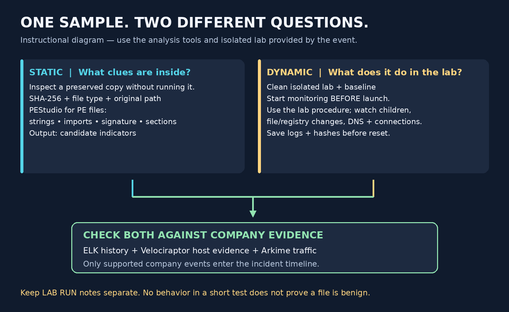

# Answer the next question

[Plan](README.md) · [Timeline](TIMELINE.md)

Set an **absolute incident time window**. Replace examples. ELK examples use **KQL in Kibana Discover**; Arkime uses its own syntax. Fields/logs vary; these queries are not event-tested.

## 1. Who was affected?

Start with a known host in ELK:

```text
host.name: "LAB-WIN11"
```

Read the suspicious event's user/domain, host, source IP, time, and process—not just whoever is currently logged on. Confirm the right Velociraptor client and historical host-IP mapping.

**Save:** user + hostname + IP-at-event + event reference.

## 2. What was the file?

In Velociraptor, inspect the suspicious process's **full executable path, command line, parent, user, and start time**. Acquire a file copy and record SHA-256/type/size and collection ID. Compare with historical process hashes if present.

Minimal VQL in an **endpoint** query context:

```sql
SELECT * FROM pslist()
```

This is a live snapshot, not history. Server context can inspect the server instead of the victim. Same filename does not mean same file; current bytes may differ from earlier execution.

**Save:** path + name + type + SHA-256 + evidence reference.

## 3. When did it start?

ELK, if Sysmon process creation is collected:

```text
host.name: "LAB-WIN11" and winlog.channel: "Microsoft-Windows-Sysmon/Operational" and winlog.event_id: "1"
```

Sort oldest first. Find the candidate's creation time and parent. Widen backward as needed. If only Security auditing exists, check Security / 4688. Preserve original time/zone and source event ID; use UTC only after conversion.

**Save:** earliest observed execution + parent + timeline row + coverage limit.

## 4. How did it arrive and run?

Follow the parent/children in ELK. If raw Sysmon GUID fields exist:

```text
host.name: "LAB-WIN11" and winlog.channel: "Microsoft-Windows-Sysmon/Operational" and (winlog.event_data.ProcessGuid: "REPLACE-GUID" or winlog.event_data.ParentProcessGuid: "REPLACE-GUID")
```

Prefer process GUID/entity IDs over reused PIDs. Look before execution for file arrival/download, archive extraction, scripts, or remote logons; match supporting traffic in Arkime. Nearby times alone do not establish causation.

**Save:** supported parent/arrival chain; mark missing links unknown.

## 5. What did the file do?



**Static — 3–5 minutes:**

1. Preserve a copy; record original path/type/SHA-256.
2. For PE files, use PEStudio: strings, imports, signature, sections/packing clues. Use the provided matching tool for other formats.
3. Share candidate domains, paths, commands, and persistence names. Check company evidence; strings/imports alone do not prove behavior. Check online lookup settings before external disclosure.

**Dynamic — 5–8 minutes, in the provided isolated lab:**

1. Confirm clean snapshot/reset point and approved network setup. Note lab host, clock, sample hash, and baseline.
2. Start the provided sandbox/monitor logs and packet capture **before launch**. If supplied, Procmon tracks process/file/registry activity. Arkime sees the run only if lab traffic is captured.
3. Follow the lab's launch procedure. Record command/user/start/end; watch children, dropped files, registry changes, tasks/services, DNS, and connections.
4. Save logs/report, packet references, and dropped-file hashes before lab reset.
5. Keep a separate **LAB RUN** record. Hunt those indicators in company evidence before claiming incident behavior.

No suitable lab/sample or no visible behavior? Record the limit and move on. Do not call the file benign or spend the hour forcing execution.

**Persistence in company evidence:** inspect service/task actions, startup/Run keys, WMI; Linux cron/systemd/SSH keys where relevant. Velociraptor artifacts to check in the installed catalog: Windows.System.Services, Windows.System.TaskScheduler, Windows.Network.Netstat. Review parameters/limits first.

ELK service/task events, if collected; run separately:

```text
host.name: "LAB-WIN11" and winlog.channel: "System" and winlog.event_id: "7045"
host.name: "LAB-WIN11" and winlog.channel: "Security" and winlog.event_id: ("4698" or "4702")
```

Legitimate installs match too. A registered task is not proof it ran.

**Save:** static clues + observed lab behavior + separately supported company behavior.

## 6. What did it contact?

Arkime Sessions; run separately:

```text
ip == 192.0.2.10
ip.src == 192.0.2.10 && ip.dst == 198.51.100.20
ip == 192.0.2.10 && protocols == dns
host.dns == "*example*"
```

Open details. Record endpoints/ports, first/last times, session ID, and actual packet/message time where available. Check time bounding; overlap mode can include long sessions crossing the window. HTTPS can hide content. Match endpoint/log tuples and times before assigning a process.

**Save:** domain/IP/port + occurrence interval + session/packet evidence.

## 7. Was anyone else affected?

ELK, only where hashes are indexed; run separately:

```text
process.hash.sha256: "REPLACE-SHA256"
file.hash.sha256: "REPLACE-SHA256"
```

Also check distinctive commands, persistence entries, and verified destinations. Review each host's context and execution evidence. No results may mean missing logs, wrong filters, or incomplete coverage.

**Save:** confirmed/suspicious hosts + supporting events + unassessed gaps.

## 8. Can we prove our answers?

Check each answer against saved evidence. Use [TIMELINE.md](TIMELINE.md) to order events, preserve time caveats, and keep lab results separate. Confirm the requested path/user/hash/time format before submitting.

References: [KQL](https://www.elastic.co/docs/reference/query-languages/kql), [Arkime](https://github.com/arkime/arkime/blob/main/viewer/vueapp/src/components/help/Help.vue), [Velociraptor](https://docs.velociraptor.app/docs/), [Sysmon](https://learn.microsoft.com/en-us/sysinternals/downloads/sysmon), [PEStudio](https://www.winitor.com/), [Procmon](https://learn.microsoft.com/en-us/sysinternals/downloads/procmon). Extra tools are optional if provided, not installations to perform during the hour.
