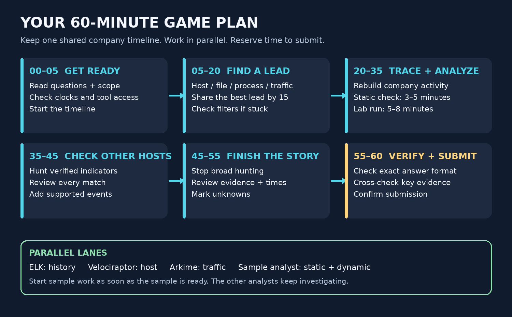

# Solve the questions. Build the timeline.

**One hour. Three files:** this guide, [QUERIES.md](QUERIES.md), and [TIMELINE.md](TIMELINE.md).

Read the actual competition questions first. Use their order and requested answer format. The query reference includes Velociraptor artifacts/VQL, Arkime filters, and ELK/KQL searches under the same question headings. The questions below are a simple path for an unknown-malware incident—not a prediction of the exact questions.

## 1. Who was affected?

Find the host and the user tied to the suspicious activity. **ELK** shows event history; **Velociraptor** checks the host. Record the account, hostname, IP at that time, and supporting event. A logged-on user is not automatically the user who ran the file.

## 2. What was the file?

Find its full path, name, type, and SHA-256 using **Velociraptor** and file/process events. Preserve a copy. A filename alone is not enough; the same file can have several names.

## 3. When did it start?

Use **ELK** to find the earliest supported execution and related earlier activity. Record the timestamp and parent process. Add the event to the **timeline now**. Collection time is not execution time; say “earliest observed” if earlier history is missing.

## 4. How did it get there and run?

Follow the parent process and earlier file/download/login evidence. Use **ELK + Velociraptor**, then **Arkime** for matching traffic. If arrival is unknown, say so.

## 5. What did the file do?

One analyst does **static analysis** for clues, then **dynamic analysis** in the provided isolated lab. Other analysts keep checking company events. Look for children, dropped files, persistence, and network activity. Use the checklist in QUERIES.md. Keep lab results separate from company history.

## 6. What did it contact?

Use **Arkime** for domains, IPs, ports, and session times. Match endpoint/log evidence before naming the responsible process. A connection alone does not prove C2 or data theft.

## 7. Was anyone else affected?

Search the verified hash, distinctive commands/paths, persistence, and destinations across other hosts. Review each match; the same file on disk does not prove execution.

## 8. Can we prove our answers and tell the story?

Use **TIMELINE.md** to put supported events in order. Each answer needs an evidence reference. Mark unknowns, check exact formats, and submit.

## Split the work; share answers

- **ELK analyst:** user, start time, parent/child history.
- **Endpoint/sample analyst:** file/hash, static analysis, controlled dynamic run, persistence.
- **Arkime analyst:** traffic, destinations, transfers.
- **Lead:** question ownership, timeline, verification, submission. Combine roles as needed.

Share: **question → answer → evidence → next question**. Add findings as you go.

## Keep the hour under control

- **0–5:** read questions, assign work, check clocks/scope/tools/lab.
- **5–20:** establish affected user/host, file, and a first useful time.
- **20–35:** trace execution and behavior; static 3–5 min and dynamic 5–8 min happen in parallel with company investigation. Start sooner if ready.
- **35–45:** check other hosts and remaining questions.
- **45–55:** stop broad hunting; finish and verify the timeline.
- **55–60:** submit and check receipts.

Use only the designated isolated lab and its launch procedure for dynamic testing. If no lab/sample or no visible behavior, record the limit and continue. Preserve evidence; change company systems only if required/allowed. Keep live samples/evidence outside GitHub unless approved.

Pictures are instructional, not tool screenshots or actual findings. Queries need local field/version checks. Actual competition rules and questions take precedence.
