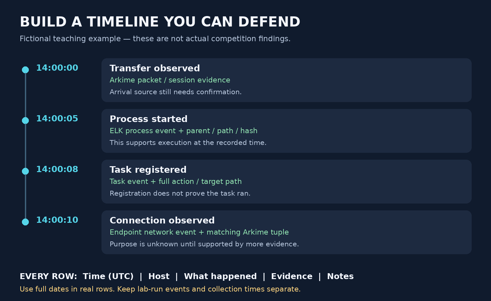

# Build the story as you investigate

[Plan](README.md) · [Quick sheet](QUERIES.md)

One person merges/reviews. Everyone contributes facts and evidence throughout the hour. Put the competition question number in Notes so every answer leads back to its supporting events.

## Copy these five columns

| Time (UTC) | Host | What happened | Evidence | Notes |
|---|---|---|---|---|
| | | | | |

- **Time:** full date/time, such as 2026-10-19T14:00:05Z. Keep start/end for intervals.
- **Evidence:** tool + event/session/collection ID + saved export and exact record/packet location.
- **Notes:** original time/timezone, relevant user/path/hash/process, uncertainty, and next check.

If the timezone or clock is unknown, retain the raw time and mark UTC unresolved. Do not invent precision. Keep raw evidence unchanged in the approved workspace.

## Keep two records

**COMPANY INCIDENT:** activity supported by the company logs, endpoints, and traffic.

**LAB RUN:** use a separate copy of the same template for dynamic-analysis results. Record lab host, sample hash, run times, conditions, and evidence. Lab behavior guides the company hunt; it does not prove the company experienced that behavior.

## Before submitting

- Sort by occurrence time—not collection or ingestion time.
- Check clock/timezone differences. Mark uncertain order.
- Merge duplicate copies of the same original event; retain references.
- Connect events using process identity, hash, or network tuple/time. Nearby times alone do not prove a chain.
- Write facts: “Task registered” does not mean “Task ran.”
- Say “earliest observed” if earlier history is missing. Mark unknowns and investigator actions clearly.

**Minute 45: finish the story. Minute 55: verify and submit.**

The picture is a fictional teaching example, not competition evidence. Real events may be missing, occur in another order, or remain unconfirmed.
